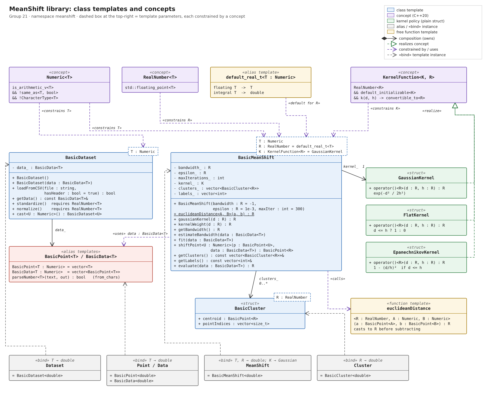
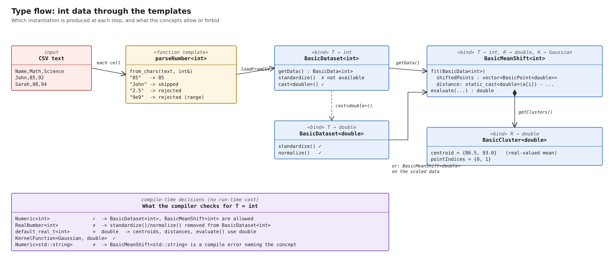

# Templates in the Mean Shift library

Group 21 · Machine Learning 13: Mean Shift Clustering in C++

This document answers the course task:

> *Identify places in your project that are good candidates for templates. Say why, describe them, describe the data types and concepts, and write design questions around template use. Make matrices, models, etc. accept all numerical data types (int, double, float, short, ...). Include appropriate concepts. Document the templates, draw UML, and rewrite the tests.*

Contents

1. [Thinking out loud: how we found the candidates](#1-thinking-out-loud-how-we-found-the-candidates)
2. [Candidate list](#2-candidate-list)
3. [The concepts](#3-the-concepts)
4. [The templates we implemented](#4-the-templates-we-implemented)
5. [Supported data types](#5-supported-data-types)
6. [UML diagrams](#6-uml-diagrams)
7. [The rewritten tests](#7-the-rewritten-tests)
8. [Design questions around template use](#8-design-questions-around-template-use)
9. [Per-member template documentation](#9-per-member-template-documentation)
10. [Behaviour changes and how to regenerate the diagrams](#10-behaviour-changes-and-how-to-regenerate-the-diagrams)

---

## 1. Thinking out loud: how we found the candidates

Our starting point was two classes, `Dataset` and `MeanShift`, and every number in them was a `double`:

```cpp
using Point = vector<double>;
using Data  = vector<Point>;
```

We asked the same question of every class and function: **"Would this code be correct if I replaced `double` with another type?"**

* **`euclideanDistance`.** The formula `sqrt(Σ (aᵢ − bᵢ)²)` makes sense for `int`, `float` or `short`. So it is a candidate. But when we tried `unsigned int`, `2u − 5u` gave `4294967293`, not `−3`. **A template doesn't just copy code to other types. It forces you to check every operation for every type.** The fix is to convert each coordinate to a floating type *before* subtracting.
  The tests found something subtler as well: `unsigned short` and `uint8_t` do *not* wrap. They are promoted to `int` before the subtraction. Only `unsigned int` and wider types break.
* **`Dataset::loadFromCSV`.** It used `stod`, which always produces a `double`. To load `int` or `short` data we need a parser that works for every type: `std::from_chars<T>` does. It also detects out-of-range values (`70000` into a `short`) instead of wrapping silently.
* **`Dataset::standardize` / `normalize`.** These compute z-scores and values in [0, 1]. On an `int` dataset every result would be truncated to −1, 0 or 1. So these functions **must not exist** for integer datasets. That is exactly what a *constrained member function* (`requires RealNumber<T>`) expresses.
* **`MeanShift::fit`.** The input can be `int`, but each shifted point is a *weighted mean*, and the mean of integers is not an integer. So the class needs **two** type parameters: the input type `T` and the compute type `R`. `R` defaults to `T` for floating types and to `double` for integers.
* **The kernel.** Only a Gaussian kernel was hard-coded, and the README listed that as a limitation. A kernel is "something you can call with (distance, bandwidth) that returns a weight". That is a **policy**, so it is another template parameter, `K`, checked by a concept.
* **`Cluster`.** It stores a centroid, which is a mean. So it is parameterised on `R`, not `T`.
* **Backward compatibility.** Six example programs and the old tests use `meanshift::Dataset`, `meanshift::MeanShift`, `meanshift::Point` and `meanshift::Data`. The standard library has the same problem with `std::string`, and solves it with `std::basic_string<CharT>` plus `using string = basic_string<char>`. We did the same: the templates are `BasicDataset`, `BasicMeanShift` and `BasicCluster`, and the old names are aliases for the `double` versions. **None of the examples needed to change.**

## 2. Candidate list

| # | Candidate | Template? | Why / why not |
|---|---|---|---|
| 1 | `Point`, `Data` (the data matrix) | **Yes**: `BasicPoint<T>`, `BasicData<T>` (alias templates) | A CSV table is a matrix of numbers; the element type should be the user's choice. |
| 2 | `Dataset` (CSV loading + scaling) | **Yes**: `BasicDataset<T>` | Same loader for `int`, `short`, `float`, `double`, etc. Scaling is constrained to floating types. |
| 3 | CSV cell parser | **Yes**: `parseNumber<T>` (function template) | One parser for every numeric type, with strict range checks. |
| 4 | `MeanShift` model | **Yes**: `BasicMeanShift<T, R, K>` | Input type, compute type and kernel are independent choices. |
| 5 | `Cluster` result | **Yes**: `BasicCluster<R>` | A centroid is a mean, so it is stored in the compute type. |
| 6 | Distance function | **Yes**: `euclideanDistance<R, A, B>` | Compares an `int` data point with a `double` centroid. |
| 7 | Kernel function | **Yes, as a policy**: `GaussianKernel`, `FlatKernel`, `EpanechnikovKernel` | Removes the "only Gaussian" limitation; resolved at compile time, no `virtual`. |
| 8 | Distance metric (Euclidean / Manhattan / cosine) | *Proposed* | Same idea as the kernel policy (`DistanceMetric<M, R>` concept). Not done yet, to keep the change reviewable. |
| 9 | A real `Matrix<T>` class (contiguous storage, rows × cols) | *Proposed* | `vector<vector<T>>` allows rows of different lengths, which is a known limitation. A `Matrix<T>` would make row width an invariant and would be faster (one allocation). The same `Numeric` concept would constrain it. |
| 10 | CSV reader with typed columns (`CsvReader<int, std::string, double>`) | *Proposed* | A variadic template could keep the name column instead of skipping it. |
| 11 | Example programs, file writing | **No** | They work with concrete files and the `double` aliases. Templating them adds complexity with no user benefit. |
| 12 | `labels_` (`vector<int>`) and `maxIterations_` (`int`) | **No** | These are counts and indices, not data values. Their type does not depend on the data type. |

Other candidates the lecturer mentioned (linear/logistic regression, CNN, GNN, numerical computing classes) are not part of the Mean Shift project. The same pattern applies to them: `Numeric T` for the data, `RealNumber R` for weights and gradients, and a policy parameter for the swappable part (loss, activation, optimiser).

## 3. The concepts

All concepts are in [`include/meanshift/Concepts.hpp`](../../include/meanshift/Concepts.hpp), so the rule for "what is a number" is written once.

```cpp
template <class T>
concept Numeric =
    std::is_arithmetic_v<T> &&
    !std::same_as<std::remove_cv_t<T>, bool> &&
    !CharacterType<T>;              // char, wchar_t, char8_t, char16_t, char32_t

template <class T>
concept RealNumber = std::floating_point<T>;

template <Numeric T>
using default_real_t = std::conditional_t<std::floating_point<T>, T, double>;

template <class K, class R>
concept KernelFunction =
    RealNumber<R> &&
    std::default_initializable<K> &&
    requires(const K k, R distance, R bandwidth) {
        { k(distance, bandwidth) } -> std::convertible_to<R>;
    };
```

| Concept | Accepts | Rejects | Used for |
|---|---|---|---|
| `Numeric<T>` | `short`, `int`, `long`, `long long` and their `unsigned` versions, `int8_t`, `uint8_t`, `float`, `double`, `long double` | `bool`, `char`, `wchar_t`, `char8/16/32_t`, `std::string`, pointers, `std::complex` | Input data type `T` of every class |
| `RealNumber<T>` | `float`, `double`, `long double` | all integers | Compute type `R`; scaling functions |
| `KernelFunction<K, R>` | any default-constructible callable `k(d, h) → R` | structs without `operator()`, callables returning non-numbers | Kernel policy `K` |

`default_real_t` is not a concept. It is a type function that chooses the default compute type.

**What the compiler says when a concept fails** (GCC 13, real output):

```text
BasicMeanShift<std::string> ms;
error: template constraint failure for '... requires Numeric<T> ...'
note: the expression 'is_arithmetic_v<T> [with T = std::string]' evaluated to 'false'

BasicDataset<int> d;  d.standardize();
error: no matching function for call to 'meanshift::BasicDataset<int>::standardize()'
note: the expression 'is_floating_point_v<_Tp> [with _Tp = int]' evaluated to 'false'
```

Compare this with an unconstrained template, where the error would point deep inside `std::sqrt` or `operator-`.

## 4. The templates we implemented

### 4.1 `BasicPoint<T>`, `BasicData<T>`: alias templates ([Dataset.hpp](../../include/meanshift/Dataset.hpp))

```cpp
template <Numeric T> using BasicPoint = std::vector<T>;
template <Numeric T> using BasicData  = std::vector<BasicPoint<T>>;
using Point = BasicPoint<double>;
using Data  = BasicData<double>;
```

`BasicData<T>` is our matrix: one row per CSV line, one column per feature (row-major).

### 4.2 `parseNumber<T>`: function template

`bool parseNumber(std::string_view text, T& out)` uses `std::from_chars`, which is overloaded for every arithmetic type.

| Input | `int` | `short` | `unsigned` | `double` |
|---|---|---|---|---|
| `" 42\r"` | 42 | 42 | 42 | 42.0 |
| `"+7"` | 7 | 7 | 7 | 7.0 |
| `"2.5"` | rejected | rejected | rejected | 2.5 |
| `"70000"` | 70000 | **rejected (out of range)** | 70000 | 70000.0 |
| `"-1"` | −1 | −1 | **rejected** | −1.0 |
| `"nan"`, `"inf"` | rejected | rejected | rejected | **rejected** (would poison every mean) |
| `"abc"`, `"12abc"` | rejected | rejected | rejected | rejected |

`if constexpr (std::floating_point<T>)` adds the NaN/inf check only for floating types. The branch is chosen at compile time.

### 4.3 `BasicDataset<T>`: class template

| Member | Notes |
|---|---|
| `BasicDataset()` / `BasicDataset(BasicData<T>)` | The second constructor is new; it makes tests and in-memory data easy. |
| `bool loadFromCSV(file, hasHeader = true)` | Uses `parseNumber<T>`. |
| `const BasicData<T>& getData() const` | |
| `void standardize() requires RealNumber<T>` | **Constrained member function.** It does not exist for `BasicDataset<int>`. |
| `void normalize() requires RealNumber<T>` | Same. |
| `template <Numeric U> BasicDataset<U> cast() const` | **Member function template.** The intended path for integer data: `raw.cast<double>().standardize()`. |

### 4.4 `BasicMeanShift<T, R, K>`: class template with three constrained parameters

```cpp
template <Numeric T,
          RealNumber R = default_real_t<T>,
          KernelFunction<R> K = GaussianKernel>
class BasicMeanShift;
using MeanShift = BasicMeanShift<double>;
```

| Parameter | Role | Default |
|---|---|---|
| `T` | type of the input data | none |
| `R` | type of distances, kernel weights, centroids, `evaluate()` | `T` if floating, else `double` |
| `K` | kernel policy object, stored as `[[no_unique_address]] K kernel_` (0 bytes) | `GaussianKernel` |

Member function templates inside the class template:
* `template <Numeric A, Numeric B> static R euclideanDistance(const BasicPoint<A>&, const BasicPoint<B>&)`: compares an `int` point with a `double` centroid.
* `template <Numeric U> BasicPoint<R> shiftPoint(const BasicPoint<U>& p, const BasicData<T>& data) const`.

New non-template members: `kernelWeight(d)` (uses `K`) and `getBandwidth()`. `gaussianKernel(d)` is kept for compatibility.

Typical uses:

```cpp
meanshift::MeanShift ms(2.0);                                   // unchanged old code
meanshift::BasicMeanShift<int> msi(20.0);                       // int data, double maths
meanshift::BasicMeanShift<short, float> mss(20.0f);             // short data, float maths
meanshift::BasicMeanShift<double, double, meanshift::FlatKernel> flat(2.0);
```

### 4.5 `BasicCluster<R>`: struct template

```cpp
template <RealNumber R>
struct BasicCluster { BasicPoint<R> centroid; std::vector<std::size_t> pointIndices; };
using Cluster = BasicCluster<double>;
```

### 4.6 Kernel policies ([Kernels.hpp](../../include/meanshift/Kernels.hpp))

Each is a stateless struct with a templated call operator `template <RealNumber R> R operator()(R d, R h) const`.

| Kernel | Weight |
|---|---|
| `GaussianKernel` (default) | `exp(−d² / 2h²)` |
| `FlatKernel` | `1` if `d ≤ h`, else `0` |
| `EpanechnikovKernel` | `1 − (d/h)²` if `d ≤ h`, else `0` |

A user can write their own kernel without inheriting from anything. The tests define a `TriangularKernel` this way.

### 4.7 Where the code lives: header vs. `.cpp`

Template code has to be visible where it is used, so all definitions are now in the headers. The `.cpp` files still exist. They contain **explicit instantiations** for the common types:

```cpp
// src/MeanShift.cpp
template class BasicMeanShift<int>;
template class BasicMeanShift<float>;
template class BasicMeanShift<double>;
```

The headers declare the same types `extern template ...;`. Code that uses `MeanShift` links against the copy already compiled into `libmeanshift.a` instead of recompiling it. Any other type (`short`, `long`, `uint8_t`, ...) is instantiated on demand from the header.

## 5. Supported data types

Every type below is run through every applicable test (see §7):

| Type | `Numeric` | `RealNumber` | default `R` | `standardize()` | Note |
|---|---|---|---|---|---|
| `short`, `unsigned short` | ✓ | ✗ | `double` | via `cast<double>()` | promoted to `int` in arithmetic |
| `int`, `unsigned int` | ✓ | ✗ | `double` | via `cast<double>()` | `unsigned` wraps if subtracted directly |
| `long`, `unsigned long`, `long long`, `unsigned long long` | ✓ | ✗ | `double` | via `cast<double>()` | values above 2⁵³ lose precision in `double` |
| `int8_t`, `uint8_t` | ✓ | ✗ | `double` | via `cast<double>()` | `cout << int8_t` prints a *character* |
| `float` | ✓ | ✓ | `float` | ✓ | about 7 significant digits |
| `double` | ✓ | ✓ | `double` | ✓ | the old behaviour |
| `long double` | ✓ | ✓ | `long double` | ✓ | |
| `bool`, `char`, `std::string`, `T*` | ✗ | ✗ | none | none | compile error naming the concept |

## 6. UML diagrams

Images: [`uml/class-diagram.png`](uml/class-diagram.png) and [`uml/type-flow.png`](uml/type-flow.png). The SVG versions sit next to them, and both are generated by [`uml/make_uml.py`](uml/make_uml.py).

### 6.1 Class diagram



How to read it (standard UML template notation):

* The **dashed box at the top-right** of a class lists its template parameters and the concept that constrains each one.
* **Purple dashed arrows («constrains»)**: a concept restricts a template parameter.
* **Filled diamond (composition)**:
  * `BasicMeanShift` owns its `kernel_` (multiplicity 1) and its `clusters_` (0..*).
  * `BasicDataset` owns its `data_`.
* **Hollow triangle, dashed («realize»)**: `GaussianKernel`, `FlatKernel` and `EpanechnikovKernel` satisfy the `KernelFunction` concept. In C++ this is structural: there is no base class.
* **Grey dashed arrows («bind»)**: `Dataset`, `MeanShift`, `Cluster`, `Point` and `Data` are template instances with the parameters bound to `double`.
* **«uses» / «calls»**: `BasicMeanShift` takes `BasicData<T>` as input and calls the free function `euclideanDistance<R, A, B>`.
* There is **no inheritance** in the design. Variation comes from template parameters (static polymorphism), not virtual functions.

### 6.2 Type flow for `T = int`



This diagram follows one concrete type through the library. It shows which instantiation the compiler creates at each step, and what the concepts allow or forbid. For example, `BasicDataset<int>` has no `standardize()`, but `cast<double>()` yields a `BasicDataset<double>` that does.

## 7. The rewritten tests

File: [`tests/test_meanshift.cpp`](../../tests/test_meanshift.cpp). Run with `ctest --output-on-failure` from the build folder.

**Layer 1: compile-time tests (`static_assert`).** If any of these fails, the test program does not compile. They check:
* `Numeric` accepts all 13 numeric types and rejects `bool`, `char`, `wchar_t`, `char8/16/32_t`, `std::string`, `int*` and `std::complex<double>`.
* `default_real_t` maps integers to `double` and keeps floating types.
* `BasicDataset<std::string>`, `BasicMeanShift<char>` and `BasicMeanShift<int, int>` cannot be formed. This is tested with `requires { typename X<T>; }`.
* `standardize()` / `normalize()` exist on `BasicDataset<double>` but not on `BasicDataset<int>`.
* `KernelFunction` accepts the built-in kernels and a user-written `TriangularKernel`. It rejects a struct with no call operator and one that returns `std::string`.
* The old names are exactly the `double` instances.
* `BasicMeanShift<int>` produces `BasicCluster<double>`, and `BasicMeanShift<short, float>::evaluate` returns `float`.

**Layer 2: typed run-time tests.** Each test is a function template, run once per type by a small helper:

```cpp
forEachType<NUMERIC_TYPES>("testMeanShiftClustering", []<class T>() { testMeanShiftClustering<T>(); });
```

`NUMERIC_TYPES` covers `short`, `unsigned short`, `int`, `unsigned int`, `long`, `unsigned long`, `long long`, `unsigned long long`, `int8_t`, `uint8_t`, `float`, `double` and `long double`. The test data uses integer coordinates (0, 1, 2 and 100, 101, 102), so the same data is valid even for `uint8_t`.

| Test | What it checks |
|---|---|
| `testEuclideanDistance` | 3-4-5 triangle, symmetry, zero distance |
| `testDistanceNoUnsignedWrap` | **new**: \|2 − 5\| = 3 for unsigned types |
| `testDistanceMixedTypes` | **new**: `int` point vs `double` centroid |
| `testGaussianKernel` | k(0) = 1, k(h) = e^(−½), and that `kernelWeight` uses the Gaussian by default |
| `testShiftPoint` | the midpoint of two points stays put |
| `testMeanShiftClustering` | 2 clusters, real-valued centroids ≈ (1,1) and (101,101), 3 points each |
| `testGetLabels` | labels match the blobs |
| `testEstimateBandwidth` | automatic bandwidth > 0 and still 2 clusters |
| `testEvaluate` | cohesion ≈ 4√2/6 |
| `testEmptyData` | no clusters, no labels, score 0 |
| `testRefitResetsState` | **new**: a second `fit()` replaces the first result |
| `testKernelPolicies` | **new**: Flat, Epanechnikov and a user-defined kernel all find 2 clusters |
| `testCustomComputeType` | **new**: `BasicMeanShift<T, float>` |
| `testLoadFromCSV` | per-type CSV loading and a missing file |
| `testLoadFromCSVMessyInput` | **new**: name column, spaces, `+`, Windows `\r\n`, blank lines |
| `testLoadFromCSVNoHeader` | `hasHeader = false` |
| `testParseNumber` | **new**: `2.5` rejected for ints, max+1 rejected, `-1` rejected for unsigned, `nan`/`inf` rejected for floats |
| `testStandardize`, `testNormalize` | `float`, `double` and `long double` only |
| `testScalingConstantColumn` | **new**: no divide-by-zero |
| `testCastThenScale` | **new**: integer data → `cast<double>()` → standardize |
| `testPipelineFromCSV` | **new**: end-to-end CSV<T> → MeanShift<T> |
| `testLegacyAPI` | the original `double` API and test data still work |

Current result: **865 checks, 0 failures**. The suite is also clean under `-Wall -Wextra -Wpedantic -Wshadow` with AddressSanitizer and UBSan enabled.

**Do the tests detect bugs?** We checked by putting the unsigned bug back (`static_cast<R>(a[i] - b[i])`). Nine typed tests then failed, all for `unsigned int`, `unsigned long` and `unsigned long long`. That is how we learned about the integer-promotion subtlety described in §1.

## 8. Design questions around template use

Each question gives the answer we chose and the reason. The ones marked *open* are good for group discussion.

**A. What should be a template parameter?**

1. *Which types should a model accept, and who decides?* We decided with a named concept (`Numeric`) instead of leaving the template unconstrained. Is excluding `char` but allowing `int8_t` the right line? Our reason: `int8_t` is a number in practice, while `char` is usually text.
2. *Should `bool` be numeric?* We said no. A 0/1 feature is better stored as `uint8_t` or `int`, so that sums and means are not done in `bool`.
3. *Should the compute type be fixed (`double`), follow the input (`T`), or be a separate parameter?* We made it a separate parameter `R` with a smart default. *Open:* is `float` input → `float` maths the right default, given that `float` loses precision when summing many weights?
4. *Policy template parameter or virtual base class for the kernel?* We chose a policy: there is no run-time cost, it can be inlined, and it is checked by a concept. The cost is that the kernel cannot be chosen at run time (for example from a config file). *Open:* should we also offer a `std::function`-based kernel for that case?
5. *Should the distance metric also be a policy?* (Proposed, §2.) Each new parameter makes the type name longer. When do we stop?

**B. Concepts and constraints**

6. *Constrain the class, or constrain individual member functions?* We did both. The class requires `Numeric<T>`, and `standardize()` additionally requires `RealNumber<T>`. The alternative is a separate `RealDataset` class. Which is easier for users to understand?
7. *Should `KernelFunction` require `noexcept`, or a return value in [0, 1]?* Concepts can check syntax but not values. Where do we document and test the semantic requirements?
8. *What do users see when they get it wrong?* We captured the real compiler messages (§3). Are they understandable for a first-year user?

**C. Conversions and numerical correctness**

9. *Where should conversion happen?* We convert each value to `R` before arithmetic, because subtracting unsigned values first wraps. Should `euclideanDistance` refuse mixed signed/unsigned inputs instead?
10. *How should CSV parsing handle `2.5` when `T = int`?* Options are to truncate, round, or reject. We reject, the strictest option. Is that too strict for real data, where a column may contain both integers and decimals?
11. *`long long` values above 2⁵³ cannot be represented exactly in `double`.* Should `default_real_t<long long>` be `long double`?
12. *`cast<U>()` from `double` to `int` truncates.* Should it be allowed at all, or only widening conversions (checked with a concept such as "U can represent every value of T")?

**D. Code organisation and build**

13. *Header-only, or a compiled library with explicit instantiations?* We kept `libmeanshift.a` with `int`, `float` and `double` instantiated (`extern template`). Which types should be pre-compiled?
14. *How do we keep the old API working?* We used the `std::basic_string` / `std::string` pattern (`BasicX<T>` + `using X = BasicX<double>`). The alternative is C++20 class-template argument deduction. Why didn't that work here? (Hint: `meanshift::Data data = {{0.0, 0.0}, ...}` cannot deduce `T` through nested braces.)
15. *Should `Point`/`Data` stay as `vector<vector<T>>`, or become a `Matrix<T>` class?* A `Matrix<T>` would check that all rows have the same width, a current limitation.

**E. Testing templates**

16. *How do you test "every numeric type" without copying tests 13 times?* We used function templates, a type list and `forEachType`. Frameworks such as GoogleTest's `TYPED_TEST` do the same.
17. *How do you test that something does **not** compile?* We used `static_assert(!requires { ... })`. A test that expects a compile failure cannot be run with a normal test runner.
18. *Which tolerance should tests use for `float` vs `long double`?* We use one tolerance per check that is loose enough for `float`. *Open:* should the tolerance be derived from `std::numeric_limits<R>::epsilon()`?

## 9. Per-member template documentation

The task asks *each member* to document the templates in their own assigned part. The table maps each member's original functions (from the README contribution table) to what those functions became. Each member should then fill in **their own** section below in their own words: what they reviewed, what they understood and any diagram they drew. Those sections are deliberately left as prompts; no one else should write them.

| Member | Original work | Now part of these templates | Template concepts to explain |
|---|---|---|---|
| Musiitwa Joseph | CMake, tests set-up | `src/*.cpp` explicit instantiations, `tests/test_meanshift.cpp` | `extern template`, typed tests, `static_assert` |
| Muhindo Nazarene | `fit()` shifting loop, `MeanShift.hpp` | `BasicMeanShift<T,R,K>::fit` | separate input/compute types, `vector<BasicPoint<R>>` |
| Mark Jordan | `example2.cpp`, class diagrams | UML in `docs/templates/uml/`, this document | UML template notation, «bind», «realize» |
| Atuzarirwe Happy | `standardize()`, `normalize()` | `BasicDataset<T>::standardize/normalize` | constrained member functions (`requires RealNumber<T>`) |
| Kizza Johnson | `Dataset`, `loadFromCSV`, `getData` | `BasicDataset<T>`, `parseNumber<T>`, `cast<U>()` | `std::from_chars<T>`, `if constexpr`, member function templates |
| Atugonza Simon | `euclideanDistance` | `euclideanDistance<R, A, B>` | mixed-type templates, unsigned wrap, integer promotion |
| Muzaki Desire | cluster formation in `fit()` | cluster merge stage of `fit`, `BasicCluster<R>` | struct templates, why the centroid uses `R` |
| Clive | `getClusters`, `getLabels`, `evaluate` | same, now returning `R` / `BasicCluster<R>` | return types depending on template parameters |
| Sserunkuma Jonathan | `estimateBandwidth`, `shiftPoint` | same + kernel policies, `KernelFunction` | policy-based design, `shiftPoint<U>` |

<details>
<summary>Section template for each member (copy into <code>reports/Individual reports/&lt;name&gt;.md</code>)</summary>

```markdown
## Templates in my part: <your name>

**My functions / classes:** ...

**Template(s) involved:** e.g. `BasicDataset<T>::standardize() requires RealNumber<T>`

**Template parameters and their concepts:**
| Parameter | Concept | Why this concept |
|---|---|---|

**Data types I tested it with:** (from the typed tests or your own tries)

**One thing that broke or surprised me when the code became a template:**

**One design question from §8 I would answer differently, and why:**

**My UML sketch:** (photo or drawing of the part you own; show the template-parameter box and any relations)

```

</details>

## 10. Behaviour changes and how to regenerate the diagrams

Changes that are visible to existing `double` users:

* `loadFromCSV` is stricter. A partially numeric cell such as `12abc` was read as 12 by `stod`; it is now skipped. `nan` and `inf` cells are skipped too. Windows `\r\n` files and cells with spaces now load correctly.
* `fit()` clears the previous clusters and labels at the start, even when the new data is empty. Before, a fit on empty data kept the old result.
* The headers no longer contain `using namespace std;`. Putting that in a header affects every file that includes it. All the examples already had their own `using namespace std;`, so nothing changed for them.
* There is a new header, `meanshift/Kernels.hpp` (included by `MeanShift.hpp`), and another, `meanshift/Concepts.hpp`.

Regenerate the diagrams after changing a class:

```bash
python3 docs/templates/uml/make_uml.py
```

This writes the SVG files. To make PNGs, open an SVG in a browser and take a screenshot, or use any SVG-to-PNG converter.
